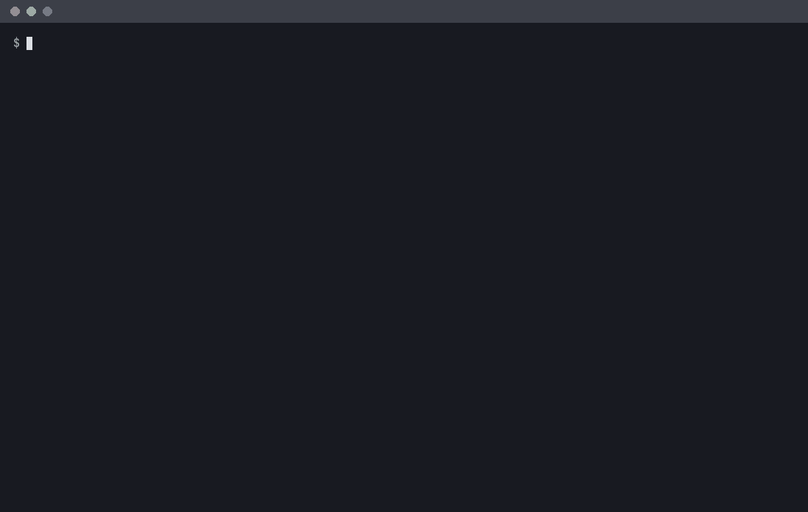

# picfind 🔎 - find the web page that shows an image

[](https://github.com/asidko/picfind/actions/workflows/ci.yml)
[](https://github.com/asidko/picfind/releases/latest)
[](go.mod)
[](LICENSE)



You have a picture, or just its aHash, and a website. `picfind` crawls the site, hashes every
image it finds and tells you which page shows yours - even when the site serves it resized or
recompressed. One ~6 MB binary, nothing else to install.

## Install

**Install script (recommended)** - Linux and macOS, x86_64 and arm64. Puts `picfind` in
`~/.local/bin` and verifies its SHA256 checksum:

```
curl -fsSL https://raw.githubusercontent.com/asidko/picfind/main/install.sh | sh
```

Pin a version with `| sh -s -- --tag v1.0.0`, uninstall with `| sh -s -- --remove`.

**Manual** - download `picfind-<os>-<arch>` from the [latest release](https://github.com/asidko/picfind/releases/latest),
`chmod +x` it and move it onto your `PATH` as `picfind`.

**From source** - see [Build from source](#build-from-source).

## Quickstart

```
picfind https://example.com --image-file photo.jpg                     # where on example.com is photo.jpg?
picfind https://example.com 3c7e7e3c18183c7e                           # same, when you only have the hash
picfind https://example.com/gallery/ --image-file photo.jpg --stay-under   # only inside /gallery/, as deep as it goes
picfind --image-file photo.jpg                                         # just print the hash of photo.jpg
```

## Results

Everything is printed in the terminal; `picfind` writes no files. Images are hashed while the
crawl is still running, and every match is printed the moment it is found, on its own line:

```
[FOUND] distance 0  image: https://example.com/media/photo-1280.jpg  page: https://example.com/gallery/42
```

On a terminal the `[FOUND]` tag is bold green so it stands out from the progress lines. The crawl
keeps going - press Ctrl-C once you have what you need. When it is done it prints the closest
images, best first, and a verdict. Real final output from the demo above:

```
=== 647 images hashed, 0 failed | closest to 183e52c3cbce1c18 ===
dist  hash              image, then the page it is on
   0  183e52c3cbce1c18  https://books.toscrape.com/media/cache/5d/7e/5d7ecde8e81513eba8a64c9fe000744b.jpg
                        https://books.toscrape.com/catalogue/category/books/thriller_37/index.html
  17  187ecbdbd83e3c00  https://books.toscrape.com/media/cache/3e/0b/3e0b16851bec08b6cbf78d5f64af9114.jpg
                        https://books.toscrape.com/catalogue/category/books/fantasy_19/index.html
  18  007e7e73724e1e00  https://books.toscrape.com/media/cache/ca/30/ca30b1afe1e76ce7ba1db8176d398e53.jpg
                        https://books.toscrape.com/catalogue/vagabonding-an-uncommon-guide-to-the-art-of-long-term-world-travel_552/index.html
match: distance 0
  image: https://books.toscrape.com/media/cache/5d/7e/5d7ecde8e81513eba8a64c9fe000744b.jpg
  page:  https://books.toscrape.com/catalogue/category/books/thriller_37/index.html
```

- Each result is two lines: the distance, the image's hash and the image URL, then the page that shows that image.
- `dist` counts how many of the 64 hash bits differ: 0-4 is the same picture (a resized or recompressed copy usually scores 0-4), 7 and up is a different one. Here the full-size cover matched its own thumbnail at 0.
- The last block is the answer: `match:` with the image and page URLs, or `no match: best distance N`. If more images fall within the match distance, a `note:` line says so - check them, plain images can match look-alikes.
- There is no page limit by default: the crawl visits every page it can reach. With `--max-pages N` it stops after N pages, and a `note:` says how many pages were left unvisited. A limited crawl from the homepage spreads its pages across the whole site, so it can miss what a crawl of one section with `--stay-under` finds.
- Keep the results: `picfind ... > results.txt` saves them to a file, progress stays on screen.

## What's New in v1.0.0

- First release: one static binary for Linux and macOS, no runtime needed.
- Matches show up live as `[FOUND]` lines while the crawl is still running; no page limit by default.
- `--image-file photo.jpg` hashes the picture for you; `picfind --image-file photo.jpg` alone prints its hash.
- Takes the 16-hex aHash or the long 32-hex form (its first 16 hex are the aHash).
- Same hashes as Python `imagehash`, so hashes made there work here.
- `--stay-under` crawls one section of a site as deep as it goes; `--visit-pages-regex` and `--visit-images-regex` choose exactly which pages to visit and which images to hash.

## Usage

**What to look for** - pick one:

- `<hash>` - a 16-hex aHash such as `3c7e7e3c18183c7e`, or a 32-hex hash whose first 16 hex are the aHash.
- `--image-file photo.jpg` - hash a local JPEG, PNG, GIF, WebP or BMP.

**Pages to visit** - pick one way in:

- Crawl a site (default): start at `<url>` and follow every link on the same host, no page limit. `--max-pages N` caps it, `--all-hosts` follows other hosts too.
  ```
  picfind https://example.com 3c7e7e3c18183c7e
  ```
- Crawl only one section: `--stay-under` follows links under the path of `<url>` at any depth and never leaves it - no `/news/`, no homepage, no other hosts.
  ```
  picfind https://example.com/gallery/ 3c7e7e3c18183c7e --stay-under
  ```
- Numbered listing pages: `<url>` is page 1, `--page-template` builds the others.
  ```
  picfind https://example.com/forum.html 3c7e7e3c18183c7e --page-template 'https://example.com/forum-{n}.html' --pages 2-100
  ```
- Your own list of pages, one URL per line, `#` starts a comment:
  ```
  picfind 3c7e7e3c18183c7e --urls-file pages.txt
  ```

`--visit-pages-regex` narrows which pages get visited:

- When crawling: only links whose URL matches are followed, at any depth (the start page is always visited). Use it when one path prefix is not enough, e.g. galleries and albums:
  ```
  picfind https://example.com/ 3c7e7e3c18183c7e --visit-pages-regex '/(gallery|album)/'
  ```
- With numbered pages or a list: links on those pages that match are visited too, one hop - for example the threads linked from forum listings:
  ```
  picfind https://example.com/forum.html --image-file photo.jpg --page-template 'https://example.com/forum-{n}.html' --pages 2-100 --visit-pages-regex '/thread-[0-9]+'
  ```
- A link that ends in `.jpg`, `.png` and so on is hashed as an image, and visited as a page only when it matches. That reaches image hosts whose viewer pages end in `.jpg`:
  ```
  picfind 3c7e7e3c18183c7e --urls-file threads.txt --visit-pages-regex '^https://img\.example\.net/'
  ```

**Images to hash** - `--visit-images-regex` hashes only the images whose URL matches, e.g. only the
host that serves the photos. The biggest speedup on image-heavy sites:

```
picfind https://example.com 3c7e7e3c18183c7e --visit-images-regex '^https://img\.example\.com/'
```

**Output and speed**

- `--top 20` results shown, `--max-dist 4` what counts as a match, `-v` logs every page or image that failed.
- `--workers 16`, `--page-workers 16` - parallel image / page downloads. Lower them if a site starts answering HTTP 429; `picfind` already backs off and retries.
- Ctrl-C stops crawling and finishes hashing the images already found; a second Ctrl-C stops hashing too. The results so far are always printed.

Exit codes: `0` done (match or not), `1` runtime error, `2` usage error, `3` site unreachable, `130` interrupted.
Everything else: `picfind --help`.

## Why

Reverse image search engines only know the pages they have indexed, and you cannot point them at
one site, a members area, or page 4000 of a forum. `picfind` goes to the site itself: you choose
the pages, it compares every image on them with yours and hands you the page URL.

## How it compares

- [PimEyes](https://pimeyes.com/) - face search over its own index: finds photos of the same person, but only on pages it has crawled. `picfind` searches by the same image hashes PimEyes uses - paste its 32-hex hash as is - and finds the exact image on any site you point it at.

## Configuration

None. No config file, no data directory - everything is a flag.

## Build from source

Needs Go 1.27+.

```
git clone https://github.com/asidko/picfind && cd picfind
go test ./...
./build.sh        # dist/picfind-<os>-<arch> for this machine
./build.sh all    # every release target plus SHA256SUMS
```

**Architecture.** `main.go` is only the CLI. `internal/crawl` fetches pages (with 429 backoff),
extracts links and image URLs and runs the crawl and list modes, feeding every new image to a
pool of hash workers while the crawl goes on.
`internal/ahash` turns image bytes into a hash and knows nothing about the network. The core
decision: hashes must equal what Python `imagehash` (Pillow) produces, because that is where
users' hashes come from. So `internal/ahash` reimplements Pillow's grayscale conversion and
Lanczos resize plus the libjpeg/libwebp color conversion instead of Go's defaults, and golden
tests pin it to Pillow's output; the release pipeline re-checks those hashes on every platform's
binary. Go's `internal/` packages keep the layers apart. Release binaries are built with the
newest Go and `GOAMD64=v2` (any x86-64 CPU since ~2009): v3/v4 measured no faster on this
workload, so they would only lock out older CPUs.

## Related

- [gitgit](https://github.com/asidko/gitgit) 🌳 - full-fledged git in your terminal, the JetBrains Git client as a TUI.
- [binance-futures-monitor](https://github.com/asidko/binance-futures-monitor) 📈 - price-level alerts for Binance futures, one small binary.
- [reverse-grill-skill](https://github.com/asidko/reverse-grill-skill) 🔥 - explains the design decisions behind existing code.

## License

[MIT](LICENSE)
